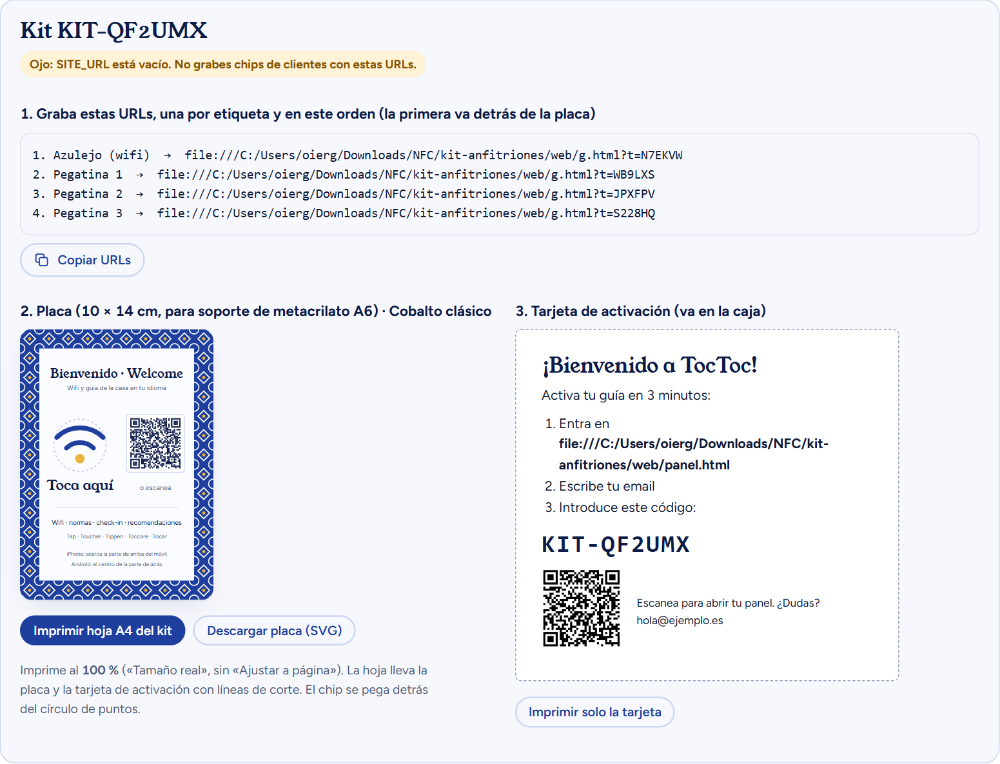

# Kit NFC para anfitriones (España): guía día a día

*Versión del 11-10-2026. Supuestos: 2 h al día, 25 € de presupuesto propio, sin Stripe y venta a anfitriones de pisos turísticos en España. Las referencias [n] remiten a la lista de fuentes del final.*

## 0. Antes de empezar: qué vas a montar y con qué

### Qué vendes
Un **azulejo NFC para la entrada de un piso turístico**:
- placa de 10 × 14 cm con diseño de azulejo, impresa por ti y montada en un **soporte de metacrilato A6**, con el chip NFC detrás y un QR de respaldo;
- 3 pegatinas NFC para la cafetera, el aire o la puerta;
- 12 meses de **guía digital editable**: wifi, llegada, electrodomésticos, normas, recomendaciones y enlace al check-in online, en 7 idiomas.

El huésped (casi siempre extranjero) acerca el móvil y ve la guía en su idioma. El anfitrión cambia lo que quiera desde el móvil sin reimprimir nada.

### Por qué en España
- **Hay muchísimos pisos turísticos** y anfitriones pequeños que gestionan desde el móvil.
- **El registro de viajeros (SES.HOSPEDAJES) es obligatorio desde el 2-12-2024** [16]. Los anfitriones necesitan que el huésped meta sus datos, y la guía lleva un botón destacado a su check-in online.
- **Cada comunidad autónoma tiene su registro turístico**, y la guía muestra su número.
  > ⚠️ El **registro único estatal (NRUA)** fue anulado en gran parte por el Tribunal Supremo en mayo de 2026 [17]. **No lo uses como argumento de venta.**
- **Vender solo en España simplifica todo:** IVA español al 21 %, sin aduanas (salvo Canarias, Ceuta y Melilla), Bizum y envíos de 24-72 h.

### Lo que ya tienes hecho (carpeta `kit-anfitriones/`)
| Carpeta o archivo | Qué es |
|---|---|
| `web/index.html` | Portada en español, con la demo en vivo (cambias la clave y el móvil de ejemplo se actualiza) |
| `web/order.html` | Pedido + pago con **Bizum, transferencia o tarjeta (PayPal)**; envío a península o Baleares |
| `web/g.html` | Lo que ve el huésped: 7 idiomas, wifi con botón de copiar, botón de registro de viajeros y nº de registro turístico |
| `web/panel.html` | Panel del anfitrión: activar kit, guía con iconos, wifi, etiquetas y estadísticas |
| `web/admin.html` | **Tu** panel: pedidos, crear kits, **hoja A4 imprimible** (placa + tarjeta de activación) y renovaciones |
| `web/legal.html` | Aviso legal (LSSI), privacidad (RGPD) y condiciones de venta (plantilla) |
| `web/config.js` | **El único archivo que editas** |
| `web/supabase/schema.sql` | Base de datos con sus permisos |
| `plantillas/` | Hoja A4 de un kit de ejemplo (PDF), azulejo de ejemplo (SVG) y hoja de pegatinas de 30 mm |

Abre `web/index.html` con doble clic: funciona en **modo demo** sin conectar nada.

### Precios recomendados para España
Las placas NFC de reseñas en Amazon.es cuestan 17-35 € (búsqueda del 11-10-2026). Por eso el kit baja a 39 €, y la cuota pasa a **anual**, porque sin Stripe no hay cobro mensual automático.

| Producto | Precio (IVA incluido) | Qué incluye |
|---|---|---|
| Kit Anfitrión | **39 €** | Placa en soporte de metacrilato + 3 pegatinas + 12 meses de guía |
| Pegatinas extra | **9 €** | 5 pegatinas NFC |
| Pack Gestor | **169 €** | 5 kits con un único acceso |
| Renovación | **24 €/año** | Desde el mes 13; sin renovar, el azulejo sigue mostrando el wifi |
| Envío | Península 4,90 € · Baleares 7,90 € | Tarifas reales **sin confirmar** [E]: compruébalas el día 13 |

**Números de un kit cobrado por Bizum o transferencia** [E]:

| Concepto | € |
|---|---|
| Precio cobrado (sin envío) | 39,00 |
| − IVA 21 % (39 / 1,21) | −6,77 |
| − Soporte de metacrilato A6 (en packs) | −1,50 [E] |
| − Cartulina y tinta (una hoja A4 a color) | −0,40 [E] |
| − 4 chips (70 por 7,99 € en Amazon.es = 0,11 € cada uno) | −0,46 |
| − Caja, tarjeta y adhesivo | −1,20 [E] |
| **Margen por kit** | **≈ 28 €** |

Con tarjeta vía PayPal resta además 2,9 % + 0,35 € (unos 1,6 €) [1]. El envío lo cobras aparte.

### En qué te gastas los 25 €
| Compra | € | Cuándo |
|---|---|---|
| 70 pegatinas NTAG213 (Amazon.es, 7,99 €) | 7,99 | Día 2 |
| Soportes de metacrilato A6 vertical, pack de 5-10 (Amazon.es, AliExpress o tienda de manualidades) | ~8-14 [E] | Día 8 |
| Cartulina blanca 250 g o papel fotográfico mate A4 (si ya tienes impresora) | ~3 [E] | Día 8 |
| **Total de tu bolsillo** | **~19-25 €** | |
| Colchón | 0-6 € | Si no tienes impresora: copistería, ~1 € por hoja a color [E] |
| Dominio `.es` (~10 €/año [E]) | — | **Con el primer cobro**, día 22 |
| Más soportes, cajas y envíos | — | **Con el dinero de cada pedido** |

**Gratis:**
- Supabase, plan gratuito (se pausa tras una semana sin uso) [5].
- Cloudflare Pages [6].
- Brevo, 300 emails al día [7].
- Formspree, avisos de pedido.
- NFC Tools.
- PayPal, solo comisión por venta [1].

### Las reglas de este plan
1. **Primero se cobra y después se fabrica.**
2. **La URL grabada en un chip es para siempre**: pon tu dominio definitivo en `config.js` antes del primer chip de un cliente (día 22).
3. **Con 2 horas al día, cada día tiene una sola meta.**
4. **Hay fechas para decidir**: días 21, 56 y 90.
5. **Antes de cobrar en serio, alta en Hacienda.** Si no eres autónomo, lee el **anexo E** antes del día 22.

---

## 1. Cómo cobrar sin Stripe (en España)

| Opción | Coste | Ventajas | Inconvenientes | Uso |
|---|---|---|---|---|
| **Bizum** | 0 € | Instantáneo y lo usa todo el mundo en España | 🔍 El Bizum de particulares es para uso personal; para cobrar como negocio pregunta a tu banco si tiene Bizum para autónomos o comercios | **Método principal** |
| **Transferencia** | 0 € | Sin comisiones; ideal para gestoras con factura | Tarda unas horas o un día | Gestores y Pack Gestor |
| **Tarjeta vía PayPal** | 2,9 % + 0,35 € por venta [1] | El cliente paga con tarjeta sin cuenta PayPal | Comisión | Quien no quiera Bizum |
| **Shopify Starter** | ~5 $/mes (precio en EE. UU.; confirma el de España) [2] | Tarjeta, Apple Pay y Google Pay sin cuenta de Stripe | Cuota mensual | Fase 2 (día 57+), con más de 8 kits al mes |

> **Canarias, Ceuta y Melilla.** Fiscalmente son envíos fuera del territorio del IVA. Llevan DUA (declaración de aduana), y el destinatario paga el IGIC o el IPSI y la gestión aduanera [18]. Por eso la web no los ofrece en el pedido: se atienden por email. 🔍 Pregunta a tu gestor cómo facturarlos antes del primero.

---

## 2. Plan día a día

**Cómo leer cada día:** 🎯 objetivo · ⏱️ tiempo · ✅ tareas · 🧨 paranoia (lo que suele salir mal).

### Semana 1 · Preparación: cuentas y web en internet

#### Día 1 · Nombre, correo y hoja de control
🎯 Tener nombre de marca, email y hoja de seguimiento. ⏱️ 2 h
✅ Tareas:
1. Elige nombre. `TocToc` es **provisional**. Compruébalo en **OEPM** (marcas en España) y **TMview** (UE), además del dominio `.es` e Instagram.
2. Crea el email de marca (un Gmail nuevo vale).
3. Crea una hoja de cálculo con 4 pestañas: **Pedidos**, **Contactos** (anfitriones a los que escribes), **Métricas** y **Gastos**.
4. Recorre la demo: portada → prueba la demo del móvil → *Ver una guía de ejemplo* → *Pedir kit* → *Entrar* (`host@demo.test`) → `admin.html` (`admin@demo.test`).

🧨 Paranoia: "Toc Toc" o "TocToc" puede estar registrado por otras empresas (inmobiliarias, apps). Si sale algo parecido en la clase 9 o 42, cambia el nombre ahora, que es gratis.

#### Día 2 · Chips y app de grabación
🎯 Tener chips y saber grabarlos. ⏱️ 1,5 h
✅ Tareas:
1. Compra **70 pegatinas NTAG213** (7,99 € en Amazon.es). NTAG213 tiene 144 bytes, sobra para la URL, y lo leen iPhone y Android.
2. Instala **NFC Tools**.
3. Lee el **anexo A**.
4. En `config.js`, rellena `BRAND`, `CONTACT_EMAIL`, `SELLER_NAME`, `SELLER_TAX_ID` y `SELLER_ADDRESS`.

🧨 Paranoia: no compres MIFARE Classic, porque los iPhone no los leen. **Las pegatinas normales no funcionan sobre metal**; para la nevera o la caldera hacen falta antimetal.

#### Día 3 · Cobros: Bizum, transferencia y PayPal
🎯 Poder cobrar por tres vías. ⏱️ 2 h
✅ Tareas:
1. Pregunta a tu banco si tu cuenta admite **Bizum para cobros de tu actividad** (algunos bancos lo ofrecen para autónomos o comercios). Pon el móvil en `BIZUM_PHONE`.
2. Pon tu IBAN y titular en `IBAN` e `IBAN_HOLDER` (mejor una cuenta separada para el negocio).
3. Crea **PayPal Business** (gratis) y tu enlace **PayPal.me** → `PAYPAL_ME`. Comprueba en incógnito que aparece "Pagar con tarjeta".
4. Apunta las comisiones: Bizum y transferencia 0 €; PayPal 2,9 % + 0,35 € [1].

🧨 Paranoia:
- **PayPal:** que te paguen como "bienes y servicios", nunca como "amigos". PayPal puede retener fondos al principio; ten colchón.
- **Bizum:** guarda captura de cada pago con su concepto (`TT-XXXXXX`) para cuadrar cuentas.

#### Día 4 · Base de datos (Supabase)
🎯 La base de datos funcionando. ⏱️ 2 h
✅ Tareas:
1. En supabase.com → **New project** → región **Central EU (Frankfurt)** → contraseña fuerte.
2. **SQL Editor** → pega `web/supabase/schema.sql`. Antes de ejecutar, cambia la última línea por **tu email** → **Run**.
3. **Project Settings → API**: copia la URL y la clave **anon public** en `config.js`.

🧨 Paranoia: **nunca** pongas en la web la clave `service_role`. El proyecto gratuito se pausa tras una semana sin uso [5]: entra cada semana.

#### Día 5 · Emails de acceso (Brevo)
🎯 Que los anfitriones reciban su enlace para entrar. ⏱️ 2 h
✅ Tareas:
1. Por qué hace falta: el email que trae Supabase **solo envía a tu equipo, y como mucho 2 por hora** [10].
2. Crea una cuenta en **Brevo** (300 emails al día gratis) [7] → *SMTP & API* → copia los datos.
3. En Supabase: **Authentication → Emails → SMTP Settings → Enable custom SMTP** y pega los datos de Brevo.
4. **Authentication → Rate limits**: 30 emails por hora.
5. Plantilla **Magic Link** en español: "Tu enlace para entrar en {marca}".

🧨 Paranoia: con un Gmail como remitente, muchos enlaces caerán en spam. El día 22 verifica tu dominio en Brevo (SPF y DKIM).

#### Día 6 · Publicar la web
🎯 La web en una dirección pública. ⏱️ 2 h
✅ Tareas:
1. **Cloudflare → Workers & Pages → Create → Pages → Upload assets** → arrastra la carpeta `web` (sale `tumarca.pages.dev`).
2. Revisa las condiciones del plan gratuito [6]. **No uses Vercel Hobby: prohíbe el uso comercial** [12].
3. Supabase → *Authentication → URL Configuration* → **Site URL** = `https://tumarca.pages.dev/panel.html`, y añádela en *Redirect URLs*.
4. Crea un formulario en **Formspree** → `ORDER_NOTIFY_ENDPOINT` (te avisa por email de cada pedido).
5. Vuelve a subir la carpeta `web`.

🧨 Paranoia: cada cambio en `config.js` obliga a volver a subir la carpeta. Prueba en el móvil **con datos**, no con el wifi de casa.

#### Día 7 · Prueba de principio a fin
🎯 Un pedido falso completo. ⏱️ 2 h
✅ Tareas:
1. Haz un pedido con otro email tuyo y elige Bizum.

2. Comprueba los errores del formulario: déjate el teléfono vacío y mira que te avise.

3. Comprueba las instrucciones de pago y el aviso de Formspree.

4. En `admin.html`: **Marcar pagado** → **Crear kit**.

5. Graba la URL 1 en un chip y tócalo: debe decir "Esta etiqueta aún no está activada".

6. Con el otro email, entra en `panel.html` → código del kit → escribe una guía corta → guarda → vuelve a tocar el chip.

7. Prueba con **un iPhone y un Android**.

🧨 Paranoia: abre `admin.html` en incógnito y comprueba que **sin entrar no se ven los pedidos**.

### Semana 2 · Producto físico y material de venta

#### Día 8 · Prototipo de la placa
🎯 Una placa montada que se pueda fotografiar y que lea bien. ⏱️ 2 h
✅ Tareas:
1. Compra un pack de **soportes de metacrilato A6 vertical** (105 × 148 mm). Valen los de tipo **"en L"** (una cara, más baratos) o **"en T"** (dos caras: imprime la hoja dos veces). Que **no** tengan base metálica.
2. En `admin.html → Kits → Crear kit suelto → Imprimir hoja A4 del kit`. Sale una hoja con la placa (100 × 140 mm) y la tarjeta de activación. También tienes un ejemplo en `plantillas/hoja-kit-ejemplo.pdf`.

3. Imprime al **100 %** ("Tamaño real", nunca "Ajustar a página") en **cartulina de 250 g** o papel fotográfico **mate** (el brillante hace reflejos dentro del metacrilato).
4. Recorta por la línea de puntos con cúter y regla. Pega un chip **detrás del círculo de puntos**, por la cara de atrás del papel.
5. Mete la placa en el soporte con el chip hacia atrás y prueba la lectura con **3 móviles, con funda**: iPhone, Android y uno antiguo.

🧨 Paranoia:
- **Distancia:** el móvil queda a 2-4 mm del chip (metacrilato + papel). Un NTAG213 de 25-30 mm lee bien a esa distancia; uno de 13-20 mm puede fallar. **Pruébalo.**
- **Metal:** nada de bases, marcos ni tornillos metálicos cerca del chip. Si el anfitrión lo pone sobre una mesa metálica, que use la pegatina antimetal.
- **Tinta:** al sol la tinta normal de inyección se decolora en meses. Mejor **láser** o **tinta pigmentada**, y recomienda no ponerlo junto a una ventana.
- **QR:** escanéalo ya impreso y dentro del soporte: si hay reflejos, inclina el soporte o usa papel mate.

#### Día 9 · Acabado profesional y proveedor de soportes
🎯 Que parezca un producto de 39 €, no una manualidad. ⏱️ 2 h
✅ Tareas:
1. **Corte limpio:** cúter nuevo, regla metálica y alfombrilla de corte (~5 € [E]). Las esquinas rectas importan más que el papel.
2. **Compara 2-3 proveedores de soportes** por precio con envío: Amazon.es (rápido), AliExpress (más barato, 2-3 semanas) y tiendas de expositores de metacrilato. Objetivo: **menos de 1,50 € por soporte** en packs de 10-20.
3. Fotografía el prototipo con luz de ventana sobre una mesa de madera: será la foto principal de la web (día 11).
4. Decide los tres acabados que ofrece la web (`order.html`): **Cobalto clásico**, **Verde mudéjar** y **Blanco liso**. El panel genera cada placa con el color del pedido.

🧨 Paranoia: no compres 50 soportes hasta que el prototipo lea con 3 móviles distintos. Y quita el **film protector** del metacrilato solo al final: se raya con nada.

#### Día 10 · Una guía de ejemplo de verdad
🎯 Demo convincente. ⏱️ 2 h
✅ Tareas:
1. En tu panel, crea un piso de ejemplo con 6 secciones en **español e inglés**. Añade francés y alemán con DeepL.
2. Elige iconos para cada sección con el selector.

3. Revisa cómo se ve en el móvil.

🧨 Paranoia: en demos públicas no pongas direcciones ni códigos de caja de llaves reales.

#### Día 11 · Fotos y vídeo
🎯 6 fotos y 2 vídeos cortos. ⏱️ 2 h
✅ Tareas:
1. Fotos:
   1. el azulejo junto a la puerta;
   2. mano con el móvil tocándolo;
   3. la pantalla de la guía;
   4. pegatina en la cafetera;
   5. el kit sobre la mesa;
   6. detalle de la cenefa.
2. Vídeo 1 (15 s): *"¿Tus huéspedes te escriben a las 12 de la noche por el wifi?"* → tocar → la guía aparece.
3. Vídeo 2: cambiar la clave desde el panel en 10 segundos.

#### Día 12 · Decidir el dominio
🎯 Decidir qué dirección va en los chips. ⏱️ 1 h
✅ Tareas:
1. Las URLs grabadas tienen esta forma: `https://TUDOMINIO/g.html?t=AB12CD` y **no se pueden cambiar sin regrabar**.
2. Recomendado: comprar `tumarca.es` con el primer cobro (día 22).
3. **No grabes chips de clientes antes de poner `SITE_URL`.**

🧨 Paranoia: si dejas caducar el dominio, **todos los azulejos vendidos dejan de funcionar**. Renovación automática y 2-3 años en cuanto puedas.

#### Día 13 · Legal, envíos y precios
🎯 La letra pequeña lista. ⏱️ 2 h
✅ Tareas:
1. Revisa `legal.html` (aviso legal LSSI, privacidad RGPD y condiciones).
2. Mira tarifas en **Correos** (paquetería nacional) y en comparadores como **Packlink**. Ajusta `SHIPPING`.
3. **Facturas:** lee el **anexo E** y decide cómo vas a vender (alta en Hacienda, con o sin cuota de autónomo). **Verifactu será obligatorio desde el 1-7-2027** [13].
4. Pregunta a un gestor (una consulta suelta cuesta poco): epígrafe del IAE, IVA 21 %, factura a gestoras con CIF, Bizum para cobros de negocio y envíos a Canarias.

🧨 Paranoia: el IVA está incluido en el precio: de 39 € solo 32,23 € son tuyos. Guarda el IVA para el modelo 303.

#### Día 14 · Revisión antes de lanzar
🎯 Pasar la lista del **anexo I**. ⏱️ 2 h

### Semana 3 · Validación: ¿alguien paga?

#### Día 15 · Escuchar a los anfitriones
🎯 30 quejas literales de anfitriones. ⏱️ 2 h
✅ Tareas:
1. Lee grupos de Facebook de anfitriones en España (busca "anfitriones Airbnb", "pisos turísticos" + tu ciudad o comunidad) y foros de la comunidad de Airbnb en español.
2. Copia frases tal cual: "me escriben a las tantas por el wifi", "nunca leen el manual"…
3. Apunta qué usan ahora: carpetas, PDF por WhatsApp, Chekin, Touch Stay…

🧨 Paranoia: no publiques todavía. Muchos grupos prohíben la publicidad.

#### Día 16 · Lista de 50 clientes posibles
🎯 50 anfitriones o gestoras con contacto público. ⏱️ 2 h
✅ Tareas:
1. Instagram y TikTok: #pisoturistico, #anfitrionairbnb, #superhost, #alquilervacacional + ciudad.
2. Google: "gestión de pisos turísticos Málaga", "co-host Valencia", "gestora alquiler vacacional Mallorca".
3. Asociaciones de viviendas turísticas de tu comunidad: muchas tienen directorio o boletín y aceptan colaboradores.
4. Empresas de limpieza de pisos turísticos: entran en todos los pisos y son un canal de reventa.

🧨 Paranoia: escribe uno a uno a contactos de empresa publicados. El envío masivo de emails comerciales a particulares sin consentimiento está restringido (LSSI art. 21). 🔍

#### Día 17 · Mensajes 1-15
🎯 15 mensajes personalizados. ⏱️ 2 h
✅ Plantilla **C.2**. Oferta "anfitrión fundador": **30 % de descuento** (27,30 €) a los 10 primeros, a cambio de opinión y foto.

#### Día 18 · Mensajes 16-30 y una aportación útil
🎯 15 mensajes más y una publicación útil. ⏱️ 2 h
✅ En un grupo (si lo permite): "Lo que pongo en la guía de mis huéspedes para que no me escriban", sin enlace.

#### Día 19 · Publicar vídeos
🎯 2 vídeos en TikTok, Reels y Shorts. ⏱️ 2 h
✅ Texto: *"Que el wifi lo explique la pared, no tu WhatsApp."* Enlace en la biografía.

#### Día 20 · Seguimiento
🎯 Un recordatorio a quien no contestó. ⏱️ 2 h
✅ Apunta objeciones (precio, "ya tengo un QR", "¿y si se cae?") y prepara respuestas.

#### Día 21 · 🚦 Primera decisión
🎯 ¿Hay demanda? ⏱️ 1 h
✅ Cuenta solo los **pedidos pagados**.
- **3 o más** → sigue.
- **1-2** → sigue y repite con gestoras.
- **0** → cambia el mensaje o el segmento y repite una vez. Si vuelve a dar 0, pasa a la idea de regalos de voz reutilizando la web.

### Semana 4 · Primeros pedidos

#### Día 22 · Dominio con el primer cobro
🎯 Dirección definitiva funcionando. ⏱️ 2 h
✅ Tareas:
1. Compra `tumarca.es` con renovación automática.
2. Cloudflare Pages → *Custom domains*.
3. `config.js` → `SITE_URL: "https://tumarca.es/"` → vuelve a subir la web.
4. Supabase: actualiza *Site URL* y *Redirect URLs*.
5. Brevo: verifica el dominio (SPF y DKIM).

🧨 Paranoia: crea los kits **después** de este paso. El panel de vendedor te avisa si `SITE_URL` está vacío.

#### Día 23 · Imprimir las placas
🎯 Placas impresas con el dinero de los pedidos. ⏱️ 1,5 h
✅ `admin.html` → **Crear kit** del pedido → **Imprimir hoja A4 del kit**. Cada placa lleva su propio QR y el color que eligió el cliente.

🧨 Paranoia: imprime y monta **un kit cada vez**. Si mezclas hojas entre clientes, el QR y el chip abrirán la guía de otro.

#### Día 24 · Grabar y bloquear los chips
🎯 Chips grabados, probados y bloqueados. ⏱️ 2 h
✅ Sigue el **anexo A**: chip 1 detrás de la placa y chips 2-4 en las pegatinas. Apunta cada uno en la hoja.

🧨 Paranoia: el bloqueo es irreversible. Graba, prueba en 2 móviles y solo después bloquea.

#### Día 25 · Montaje y caja
🎯 Kits listos. ⏱️ 2 h
✅ Tareas:
1. Recorta la placa, pega el chip 1 detrás del círculo de puntos y métela en el soporte.
2. Imprime la **tarjeta de activación**, en español.
3. Imprime la hoja de pegatinas decorativas (`plantillas/pegatinas-30mm-A4.svg`).

4. Caja con la placa en su soporte (con el film protector puesto), pegatinas, tarjeta y factura o justificante. Prueba final con el móvil antes de cerrar.

#### Día 26 · Envío
🎯 Paquetes en camino. ⏱️ 2 h
✅ Envía con **seguimiento** (Correos o Packlink) → **Marcar enviado** → email con el número de seguimiento (C.6).

#### Día 27 · Escaparate gratis
🎯 Perfil de Instagram y ficha de Google listos. ⏱️ 2 h
✅ Tareas:
1. Instagram con las fotos del día 11, enlace a la web y una historia destacada con la demo.
2. **Perfil de Empresa de Google** como negocio con zona de servicio (sin dirección pública).
3. Pide a los primeros clientes una reseña ahí.

#### Día 28 · Revisión del mes 1
🎯 Métricas y aprendizajes. ⏱️ 1 h

### Mes 2 · Tracción (días 29-56)

| Día | 🎯 Tarea | Detalle y paranoia |
|---|---|---|
| 29 | **Ayudar a activar** | 3 días después de cada entrega (C.7). Un kit sin activar = cliente que no renueva |
| 30 | Gestoras | 10 mensajes con el **Pack Gestor** y un azulejo de prueba gratis |
| 31 | Empresas de limpieza | 5 propuestas de reventa con un 15 % de comisión |
| 32 | Vídeo 3 | "Antes y después": carpeta plastificada frente al azulejo |
| 33 | Grupos y foros | 5 respuestas útiles, sin enlace salvo que lo pidan |
| 34 | Asociaciones | Escribe a la asociación de viviendas turísticas de tu comunidad: ¿descuento para socios a cambio de aparecer en su boletín? |
| 35 | **Revisión semanal** | ¿Qué canal ha traído pedidos? Duplica ese |
| 36 | Opiniones | Frase y foto de clientes activados → sección nueva en `index.html` |
| 37 | 10 mensajes a anfitriones | — |
| 38 | Vídeo 4 | "3 pegatinas que todo piso turístico necesita" |
| 39 | Artículo SEO 1 | "Plantilla de guía de bienvenida para pisos turísticos (gratis)" |
| 40 | Seguimiento a gestoras | — |
| 41 | Revisar costes | ¿Azulejo por debajo de 5 €? Pide precio para 20 **solo con 5 o más pedidos en cola** |
| 42 | **Revisión semanal** | Margen real por kit |
| 43 | FAQ | Añade las preguntas reales a `index.html` |
| 44 | Otra ciudad | 10 mensajes en una zona turística distinta (Canarias, solo si ya resolviste el envío) |
| 45 | Vídeo 5 | Testimonio (con permiso) |
| 46 | Artículo SEO 2 | "Registro de viajeros: cómo pedir los datos al huésped antes de que llegue" |
| 47 | Atención al cliente | Anota problemas en el anexo H |
| 48 | Prueba de precio | 7 días a 44 € para nuevos clientes y compara la conversión |
| 49 | **Revisión semanal** | — |
| 50 | 10 mensajes | — |
| 51 | Vídeo 6 | Recorrido por el panel en 30 s |
| 52 | Copias de seguridad | Exporta las tablas de Supabase a CSV |
| 53 | Cuentas | Facturas, IVA y gastos del mes → gestor |
| 54 | Colaboración | Fotógrafos de pisos turísticos: el azulejo sale en sus fotos |
| 55 | Recuperación | Termina lo que se quedó atrás |
| 56 | **🚦 Segunda decisión** | **Sigue si:** 10 o más kits y 70 % o más activados. **Replantea si:** 5-9. **Para si:** menos de 5 |

### Mes 3 · Recurrencia y escala (días 57-90)

| Día | 🎯 Tarea | Detalle y paranoia |
|---|---|---|
| 57 | ¿Shopify Starter? | Si vendes más de 8 kits al mes y te piden tarjeta o Apple Pay → `SHOPIFY_CHECKOUT_URL` |
| 58 | Página para gestoras | Sección propia con Pack Gestor, factura con CIF y soporte |
| 59 | 10 mensajes a gestoras | — |
| 60 | Vídeo 7 | — |
| 61 | Pack piso grande | Azulejo + 6 pegatinas |
| 62 | Artículo SEO 3 | "Qué poner en la entrada de un piso turístico" |
| 63 | **Revisión semanal** | — |
| 64 | Programa de recomendación | 5 pegatinas gratis por cada anfitrión que traiga otro |
| 65 | Mejorar el panel | La función más pedida |
| 66–70 | Ritmo | Mensajes, vídeo, foros, soporte y revisión semanal |
| 71 | Renovaciones | Plantilla C.8 y recordatorio en el calendario 30 días antes de cada fecha |

| Día | 🎯 Tarea | Detalle y paranoia |
|---|---|---|
| 72–75 | Caso de estudio | 1 cliente: "X mensajes menos por estancia", con sus palabras |
| 76 | Chips en lote | Con 10 o más pedidos al mes: NTAG213 en lotes de 100-500 (rfid.it ~0,39 €) [15] |
| 77 | **Revisión semanal** | — |
| 78–80 | Ferias y eventos | Jornadas de alquiler vacacional de tu comunidad: lleva 3 azulejos de demo |
| 81 | Revisión legal | Con el gestor: facturación del trimestre y Verifactu [13] |
| 83 | Stock mínimo | Con 20 o más pedidos al mes, 10 azulejos en stock (pagados con beneficios) |
| 84 | **Revisión semanal** | — |
| 85–88 | Encuesta | ¿Lo recomendarías? ¿Qué falta? ¿Renovarías por 24 €? |
| 89 | Preparar la decisión | Métricas de 90 días |
| 90 | **🚦 Decisión final** | **Escala si:** 25 o más kits, 70 % o más activados y 30 % o más de "renovaría". **Piloto automático si:** 10-25. **Para si:** menos de 10 |

---

## Anexo A · Grabar y bloquear chips NFC
1. NFC Tools → **Escribir** → **Añadir un registro** → **URL / URI**.
2. Pega la URL del kit (`admin.html → Copiar URLs`). Debe empezar por **https://** y llevar **tu dominio**.
3. **Escribir** → acerca el chip a la zona NFC del móvil.
4. **Prueba**: con la pantalla desbloqueada y sin abrir apps, acerca el chip → se abre la guía. Repite con otro sistema operativo.
5. **Bloqueo**: NFC Tools → **Otros** → **Bloquear etiqueta**. Es irreversible.
6. Apunta: código ✔ grabado ✔ iPhone ✔ Android ✔ bloqueado.

| Prueba | Resultado esperado |
|---|---|
| iPhone XS o posterior, desbloqueado | Notificación → abre la guía |
| Android con NFC activado | Abre el navegador |
| Con funda normal | Lee a 1-2 cm |
| Chip detrás del papel, dentro del soporte de metacrilato | Lee a 2-4 mm (pruébalo con tu soporte) |
| Sobre metal (pegatina normal) | **No lee**: usa antimetal |
| QR de la placa | Abre la misma guía |

## Anexo B · Puesta en marcha técnica (resumen)
1. `config.js`: marca, contacto, NIF, `SITE_URL`, Supabase, Bizum, IBAN, PayPal y Formspree.
2. Supabase: proyecto en la UE → `schema.sql` (con tu email de admin) → URL y clave anon.
3. Supabase Auth: SMTP de Brevo, límite de 30 por hora, plantilla en español, Site URL y Redirect URLs.
4. Cloudflare Pages: subir `web` → dominio propio.
5. Prueba de principio a fin (día 7).

**Seguridad (ya incluida):**
- Cada anfitrión solo ve lo suyo.
- Los pedidos solo los ve el admin.
- Los toques se guardan sin IP.
- La fecha de renovación solo la cambia el admin.
- Si la guía caduca, el huésped solo ve el wifi.

## Anexo C · Plantillas de textos

**C.1 · Texto para la web, Instagram o un anuncio**
> Azulejo NFC para la entrada de tu piso turístico. Tus huéspedes acercan el móvil y ven el wifi, la llegada, las normas y el enlace al registro de viajeros en su idioma. Lo cambias todo desde el móvil, sin reimprimir. Incluye placa con diseño de azulejo en soporte de metacrilato, con QR, 3 pegatinas NFC y 12 meses de guía editable en 7 idiomas. 39 € con envío en 2-3 días a península y Baleares.

**C.2 · Primer mensaje a un anfitrión**
> ¡Hola, {nombre}! He visto {tu piso en…/tu publicación sobre…}. Una pregunta rápida: ¿tus huéspedes te siguen escribiendo por el wifi o por cómo funciona el aire? Hago azulejos NFC para la entrada: el huésped acerca el móvil y ve el wifi y la guía de la casa en su idioma, y tú lo cambias desde el móvil cuando quieras. Busco 10 "anfitriones fundadores" en {ciudad} con un 30 % de descuento a cambio de tu opinión. ¿Te mando un vídeo de 15 segundos?

**C.3 · Mensaje a una gestora**
> Hola, {nombre}. He visto que {gestora} gestiona {n} pisos en {zona}. Hacemos azulejos NFC con guía digital editable para cada piso, todos desde un mismo acceso, con botón al check-in online de vuestros huéspedes. ¿Os vendría bien un azulejo de prueba gratis para uno de vuestros pisos? El Pack Gestor de 5 kits sale a 169 € con factura.

**C.4 · Confirmación de pedido**
> ¡Gracias por tu pedido {ref}! Para pagar: Bizum al {móvil} o transferencia al {IBAN}, con el concepto {ref}. En cuanto llegue el pago fabricamos tu kit y sale en 2-3 días laborables.

**C.5 · Pago recibido**
> Hemos recibido el pago del pedido {ref}. ¡Gracias! Ya estamos preparando tu kit; te mandamos el seguimiento cuando salga.

**C.6 · Enviado**
> ¡Tu kit va de camino! Seguimiento: {número}. Cuando llegue, entra en {dominio}/panel.html con este email y escribe el código de la tarjeta que va en la caja. Son 3 minutos.

**C.7 · Ayuda para activar**
> Hola, {nombre}. ¿Te llegó bien el azulejo? Si aún no lo has activado, lo montamos juntos en una llamada de 10 minutos, o mándame la información de tu piso y te la dejo puesta yo.

**C.8 · Renovación (30 días antes)**
> Hola, {nombre}. La guía de {piso} está activa hasta el {fecha}. Para mantener la guía completa, las pegatinas y las estadísticas otro año, la renovación son 24 €: Bizum al {móvil} o transferencia con el concepto "Renovación {piso}". Si no renuevas, el azulejo seguirá mostrando tu wifi.

**C.9 · Petición de presupuesto de soportes (cuando vendas más de 20 al mes)**
> Hola, necesito expositores de metacrilato transparente de 2-3 mm, tamaño A6 vertical (105 × 148 mm), en L, sin piezas metálicas. ¿Precio por 20, 50 y 100 unidades, plazo y envío a [ciudad]?

## Anexo D · Envíos
- **Embalaje:** caja plana o sobre acolchado grande, con el soporte envuelto y el film protector puesto. Peso aproximado del kit: 120-200 g [E], así que entra en las tarifas más baratas.
- **Seguimiento siempre**, con Correos o Packlink.
- **Península y Baleares:** 24-72 h según el servicio [E].
- **Canarias, Ceuta y Melilla:** DUA e IGIC o IPSI a cargo del destinatario [18]. Atiende por email y con el coste total cerrado antes.
- **Rotura o arañazos:** si llega dañado, repón el soporte (foto del cliente). Te cuesta menos de 2 €.

## Anexo E · Facturas si no eres autónomo (🔍 confirma con un gestor)

**Lo corto:** sin estar dado de alta en Hacienda **no puedes emitir facturas**. Lo que sí puede esperar, según tu caso, es la cuota de autónomo de la Seguridad Social. Son dos altas distintas [19][20].

| Trámite | ¿Obligatorio? | Coste | Qué te permite |
|---|---|---|---|
| **Alta en Hacienda** (censo, modelo 036) | **Sí**, para cualquier actividad económica, aunque ganes poco [19] | 0 € (online con Cl@ve o certificado) | Facturar, cobrar como negocio, IVA |
| **Alta en la Seguridad Social** (RETA, "ser autónomo") | Si la actividad es **habitual**. Ganar menos del SMI es un indicio de que no lo es, pero **no** una exención automática [20] | Tarifa plana: unos **89 €/mes** en 2026 durante 12 meses (después, según ingresos) [21] | Cotizar (jubilación, bajas) y evitar reclamaciones |

**Cómo hacerlo, paso a paso:**
1. **Fase de prueba (días 15-21):** sin cobrar todavía. Pide reservas o señales solo a conocidos si quieres, sin factura.
2. **Antes del primer cobro real (día 22):** date de **alta en Hacienda** con el modelo 036. 🔍 Pide al gestor el epígrafe del IAE (venta por internet de productos y servicio digital). Quedas exento del pago del IAE.
3. **Seguridad Social:** dos caminos.
   - **Prudente:** alta en el RETA con tarifa plana (~89 €/mes). Con 4 kits al mes ya la cubres (margen ≈ 28 € por kit).
   - **Con riesgo:** no darte de alta mientras la actividad sea esporádica y los ingresos netos queden claramente por debajo del SMI (1.221 €/mes en 14 pagas en 2026 [20]). Si vendes cada semana con una web abierta, la Seguridad Social puede considerarlo habitual y reclamarte las cuotas con recargo.
4. **IVA e IRPF:** con el alta en Hacienda cobras el 21 % de IVA (ya va incluido en los precios) y presentas cada trimestre el **303** (IVA) y el **130** (IRPF). Aunque no fueras autónomo, esos ingresos se declaran en la renta.
5. **Facturas:**
   - A particulares basta con una **factura simplificada** (hasta 400 €): número correlativo, fecha, tu NIF, concepto, total e "IVA incluido".
   - A gestoras y empresas (las que rellenan "NIF o CIF" en el pedido), **factura completa** con sus datos y el IVA desglosado.
   - Herramienta: una hoja de cálculo sirve al principio; antes del **1-7-2027** pasa a un programa compatible con **Verifactu** [13].
6. **Lo que no conviene:**
   - Las **"cooperativas de facturación"** que te dejan facturar sin alta: la Seguridad Social las ha sancionado y puedes acabar pagando tú.
   - **Cobrar a nombre de otra persona** o con su NIF.
   - Bizum de particular para cobros de negocio continuados: 🔍 pregunta a tu banco.

**Datos fiscales en la web:** cuando tengas el alta, pon tu nombre, NIF y dirección en `config.js` (`SELLER_NAME`, `SELLER_TAX_ID`, `SELLER_ADDRESS`): salen en el aviso legal, que la LSSI exige a cualquier web que venda.

Otros puntos:
- **Solo España** (península y Baleares): IVA español al 21 %; no hace falta OSS.
- **Canarias, Ceuta y Melilla:** sin IVA español (se trata como exportación); 🔍 cómo facturarlo y justificar el envío.
- **Renovaciones:** también con factura e IVA (servicio digital prestado en España).

## Anexo F · Protección de datos: lista de comprobación
- [ ] `legal.html` revisado (RGPD, LOPDGDD, LSSI).
- [ ] Supabase en una región de la UE.
- [ ] Toques sin IP ni cookies.
- [ ] Contratos de encargo del tratamiento aceptados en Supabase, Cloudflare, Brevo y Formspree.
- [ ] Procedimiento para borrar los datos de un cliente si lo pide.
- [ ] Los anfitriones no publican datos personales de terceros en la guía. La guía **solo enlaza** al check-in: los datos de los viajeros no pasan por tu web.

## Anexo G · Métricas semanales
| Métrica | Objetivo a 90 días |
|---|---|
| Mensajes enviados | 150+ |
| % de respuestas | 15 % o más |
| Pedidos pagados | 25+ |
| % de kits activados | 70 % o más |
| Margen neto por kit | 24 € o más |
| Horas por semana | ≤ 14 |

## Anexo H · Solución de problemas
| Problema | Causa | Solución |
|---|---|---|
| El iPhone no lee | Pantalla bloqueada, iPhone anterior al XS, funda con metal | Desbloquear, usar el QR, quitar la funda |
| No lee en ningún móvil | Chip sobre metal, azulejo grueso o chip dañado | Antimetal, chip delante o chip nuevo |
| No llega el enlace para entrar | SMTP sin configurar o correo en spam | Día 5, verificar el dominio en Brevo |
| "No encontramos ese código" | Código mal escrito | Los códigos no usan O, 0, I ni 1 |
| El huésped ve "no activada" | Etiqueta sin asignar | `panel.html → Etiquetas` |
| La guía solo muestra el wifi | Renovación caducada | `admin.html → Renovaciones` → "Añadir 1 año" |
| Supabase "paused" | Una semana sin uso | Reanudar y entrar cada semana |

## Anexo I · Lista de comprobación antes de lanzar
- [ ] Nombre comprobado en OEPM y TMview.
- [ ] `config.js` sin datos de ejemplo (IBAN, Bizum, NIF, email).
- [ ] Bizum para cobros de negocio confirmado con el banco.
- [ ] Alta en Hacienda (modelo 036) hecha y datos fiscales en `config.js` (anexo E).
- [ ] `SITE_URL` definitivo **antes** de los kits de clientes y dominio con renovación automática.
- [ ] Email de admin en `admins`; sin sesión no se ven los pedidos.
- [ ] SMTP propio: el enlace llega a Gmail y a Outlook.
- [ ] Prueba completa: pedido → pago → kit → chip → activación → guía.
- [ ] iPhone y Android, con y sin funda, a través del azulejo real.
- [ ] Chips con **https**, bloqueados después de probar.
- [ ] Tarifas reales de Correos o Packlink en `SHIPPING`.
- [ ] Textos legales revisados.
- [ ] Copia de seguridad (CSV) de las tablas.

---

## Lista de fuentes
Consultadas el 11-10-2026 (19-21: el 12-10-2026).

1. Tarifas de vendedor de PayPal España: https://www.paypal.com/es/webapps/mpp/merchant-fees · Shopify sobre comisiones de PayPal: https://www.shopify.com/es/blog/comisiones-paypal
2. Shopify Starter: https://ecommerce-platforms.com/es/articles/shopify-pricing-starter-vs-basic-vs-professional-vs-unlimited-which-plan-is-best-for-you · m8d (precios en España, sep-2026): https://m8d.io/shopify-precios/
5. Plan gratuito de Supabase: https://www.jetadmin.io/blog/supabase-pricing-2026-guide-to-plans-limits-and-real-world-costs/
6. Plan gratuito de Cloudflare Pages: https://costbench.com/software/cloud-infrastructure/cloudflare-pages-workers/free-plan/
7. Plan gratuito de Brevo: https://sendlayer.com/blog/best-free-smtp-servers/
10. SMTP de Supabase (solo equipo, 2 por hora): https://supabase.com/docs/guides/auth/auth-smtp · Brevo + Supabase: https://developers.brevo.com/docs/supabase-smtp-integration
12. Vercel Hobby sin uso comercial: https://schematichq.com/blog/vercel-pricing
13. Verifactu, 1-7-2027 para autónomos (RDL 15/2025): https://www.infoautonomos.com/blog/hacienda-retrasa-entrada-vigor-verifactu/
15. Precios de chips: https://rfid.it/en/iq-labels/5320-ntag213-nfc-sticker-29-mm-for-fast-and-secure-communication.html
16. Registro de viajeros SES.HOSPEDAJES (2-12-2024): Orain: https://orain.eus/es/actualidad/economia/2024/12/01/este-lunes-entra-en-vigor-nuevo-registro-de-viajeros-pese-al-rechazo-del-sector-turistico/ · Net2Rent (guía 2026): https://net2rent.com/guia-completa-ses-hospedajes/
17. Anulación parcial del registro único (TS 620/2026): Andersen: https://es.andersen.com/wp-content/uploads/2026/06/Andersen-Alerta-SENTENCIA-DEL-TRIBUNAL-SUPREMO-SOBRE-EL-REGISTRO-UNICO-DE-ARRENDAMIENTOS-DE-CORTA-DURACION.pdf · Net2Rent: https://net2rent.com/registro-unico-de-alquiler-vacacional/
18. Envíos a Canarias (DUA, IGIC): Sendcloud: https://www.sendcloud.com/es/blog/envios-a-canarias/ · Packlink: https://www.packlink.com/ca-ES/informacion-aduanas-canarias/
19. Facturar sin ser autónomo (alta en Hacienda obligatoria): Quipu: https://getquipu.com/blog/como-hacer-una-factura-si-no-soy-autonomo/ · Wolters Kluwer: https://www.wolterskluwer.com/es-es/expert-insights/facturar-sin-ser-autonomo
20. Habitualidad y SMI (STS 941/2025; SMI 2026): Infoautónomos: https://www.infoautonomos.com/?p=2609 · Grupo 2000: https://www.grupo2000.es/merece-la-pena-ser-autonomo-con-bajos-ingresos-en-2025/
21. Tarifa plana 2026 (~88,64 €/mes con el MEI): Declarando: https://declarando.es/darse-de-alta-como-autonomo/tarifa-plana-bonificaciones · Billin: https://www.billin.net/blog/requisitos-cumplir-tarifa-plana
